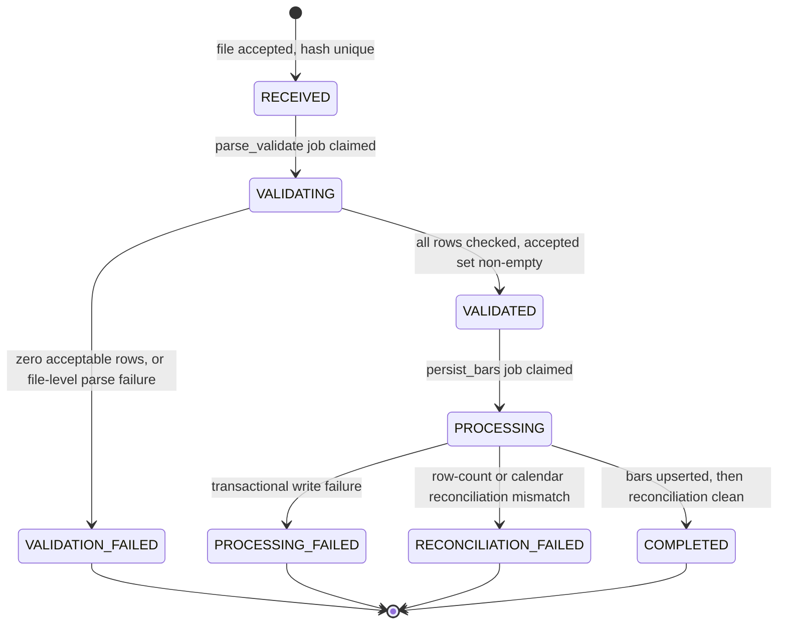
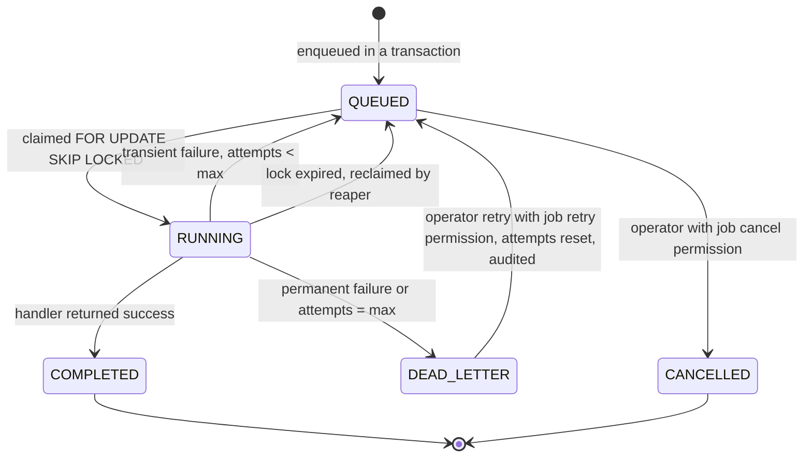
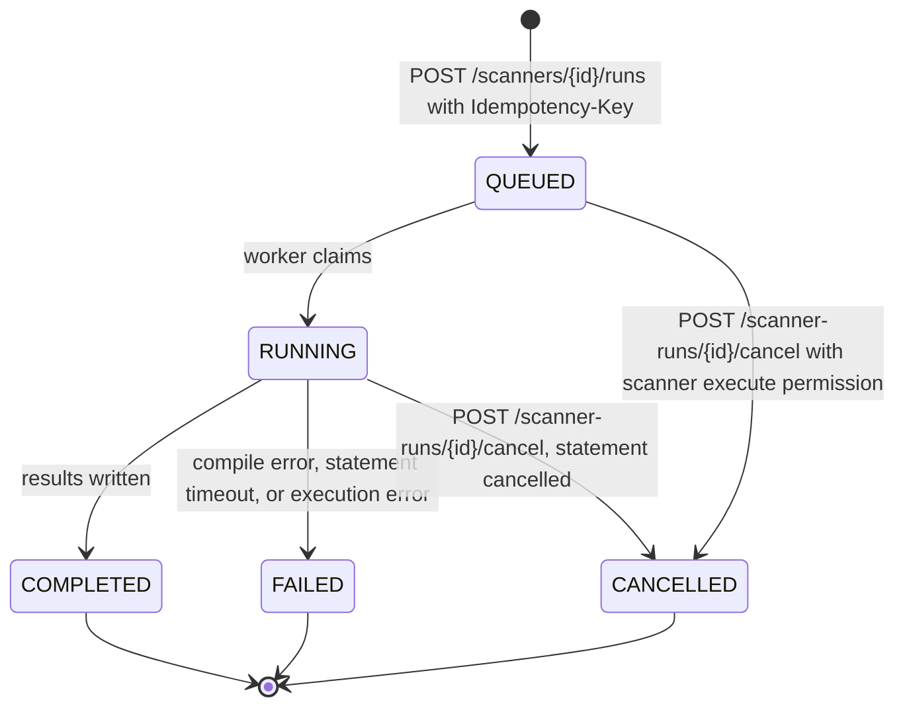
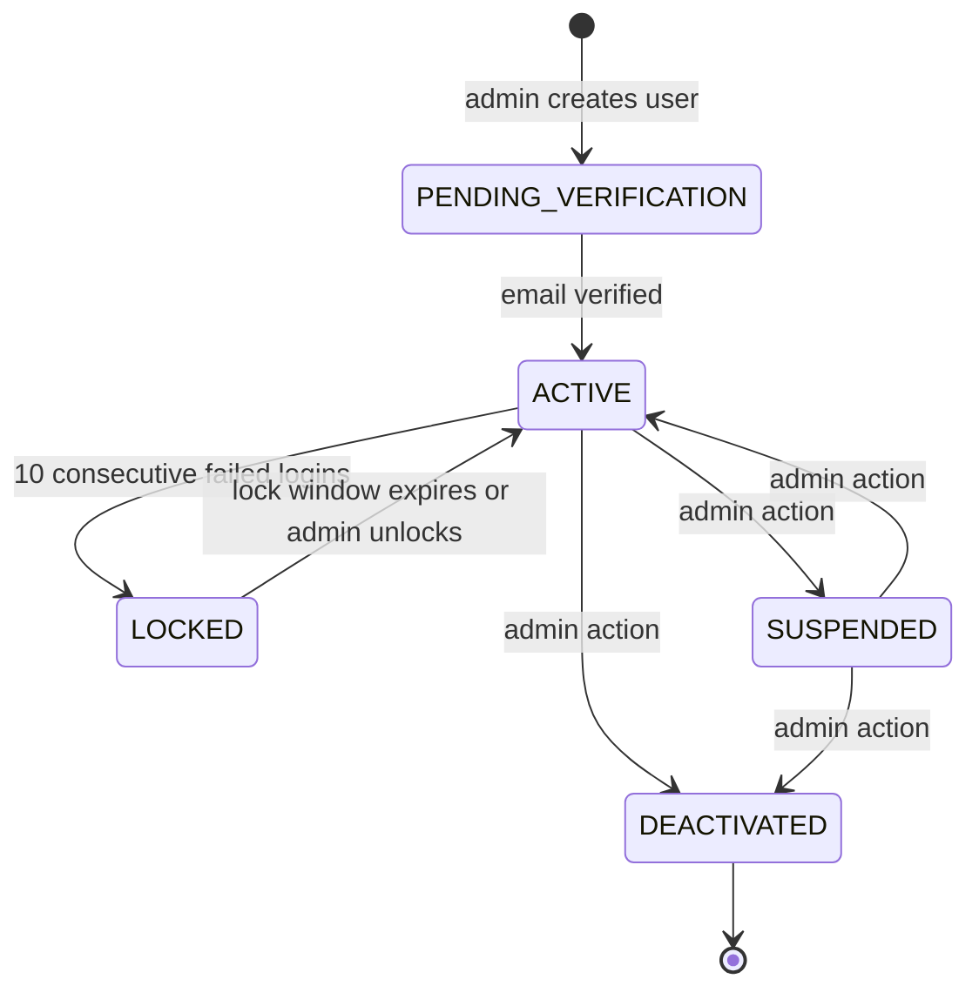
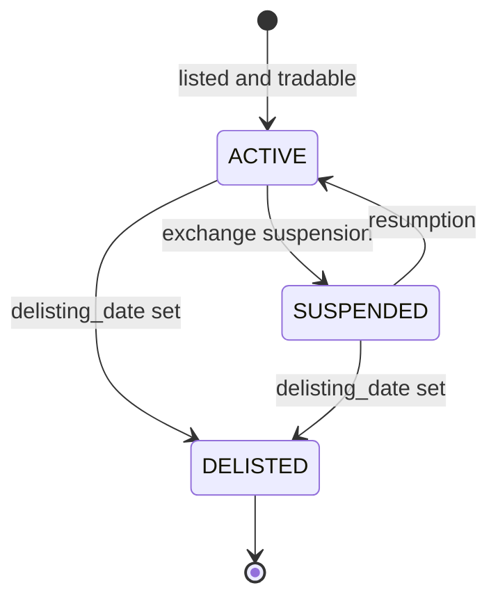

# 01 — Domain Model

Status: **APPROVED BASELINE (Phase 0)**.

The domain model is deliberately explicit. Every rule carries an identifier (`BR-*`, `INV-*`) so tests,
code comments and review comments can reference it instead of re-deriving intent.

---

## 1. Entity catalogue

`Identity` is the natural key business code may rely on. `PK` is always a UUIDv7 generated in the
application (time-ordered for index locality); append-only event tables use `bigserial`.

### 1.1 Identity & Access

| Entity | Purpose | Identity | Key rules |
|---|---|---|---|
| `AppUser` | A human principal | `email` (citext, unique) | Email immutable after verification; status gates all authentication; password hash never leaves the identity module |
| `Role` | Named permission bundle | `code` (unique, uppercase) | System roles (`ADMIN`, `ANALYST`, `VIEWER`, `INGEST_SERVICE`) cannot be deleted; `is_system` guards this |
| `Permission` | Atomic capability | `code` (unique) | Seeded, never created at runtime |
| `UserRole` | Role assignment | (`user_id`,`role_id`) | Assignment is audited with granting actor |
| `RolePermission` | Role composition | (`role_id`,`permission_id`) | Effective permissions are the union across roles |
| `AuthSession` | A refresh-token family member | `refresh_token_hash` (unique) | One row per issued refresh token; rotation creates a new row and marks the old `used_at`; reuse of a used token revokes the whole family |
| `OneTimeToken` | Password reset / email verification | `token_hash` | Single use; `purpose` scopes it; short TTL (reset 60 min per `06` §4.5, verification 24 h) |
| `ApiKey` | Machine credential | `key_prefix` (unique) | Only a hash is stored; plaintext shown once at creation; `scopes` intersect the principal's roles |

### 1.2 Market Reference Data

| Entity | Purpose | Identity | Key rules |
|---|---|---|---|
| `Exchange` | Trading venue | `code` (`NSE`,`BSE`,`MCX`,`NCDEX`,`NFO`) | Carries `timezone` and default session window; session window is data, not code |
| `TradingCalendar` | Authoritative per-date session | (`exchange_id`,`calendar_date`) | Exactly one row per exchange per date; `is_trading_day=false` rows are required for holidays (absence is not "closed") |
| `Instrument` | Tradable or indexable thing | (`exchange_id`,`symbol`,`series`) | `instrument_type` and `asset_class` drive every downstream rule; `tick_size` and `price_precision` drive Renko rounding |
| `SymbolAlias` | Historical symbol resolution | (`instrument_id`,`alias_symbol`,`valid_from`) | Ingestion resolves an unknown symbol through aliases before rejecting a row |
| `Sector` | Hierarchical classification | `code` | Self-referencing `parent_id`; `kind` ∈ `SECTOR`,`INDUSTRY`,`THEME`; cycles forbidden |
| `InstrumentSectorMembership` | Time-bounded classification | (`instrument_id`,`sector_id`,`effective_from`) | Periods may not overlap for the same instrument and sector kind |
| `IndexMembership` | Index constituents | (`index_instrument_id`,`member_instrument_id`,`effective_from`) | An index is itself an `Instrument` with `instrument_type='INDEX'`; membership is time-bounded so historical breadth is correct |
| `CorporateAction` | Splits, bonuses, dividends, mergers | (`instrument_id`,`action_type`,`ex_date`) | Drives adjustment factors; never mutates raw bars |
| `MarketGroup` | Sector/index/custom/dynamic grouping | `code` | `is_dynamic=true` means membership is rule-resolved, not stored |
| `MarketGroupMember` | Static membership | (`group_id`,`instrument_id`,`added_on`) | Removals are soft (`removed_on`), preserving history |

### 1.3 Market Data

| Entity | Purpose | Identity | Key rules |
|---|---|---|---|
| `DataSource` | Provenance of a data feed | `code` | `kind` ∈ `CSV`,`API`,`MANUAL`; holds adapter configuration (never credentials — those are env references) |
| `ImportFile` | A received artefact | `sha256` (unique) | Content-addressed; identical bytes are never re-ingested into a new batch |
| `ImportBatch` | One ingestion attempt | `id` + optional `idempotency_key` (unique) | Carries the lifecycle state; terminal states are immutable |
| `IngestionReject` | Quarantined row | `id` | Stores the raw row verbatim; never deleted before 90 days |
| `MarketBar` | Canonical OHLCV | (`instrument_id`,`timeframe`,`bucket_start`) | Raw as-traded prices; `revision` monotonically increases; `is_partial` marks truncated session buckets |
| `MarketBarHistory` | Superseded bar values | `id` | Written by trigger on revision change; supports "what did we believe on date X" |
| `BarQualityIssue` | Detected defect | `id` | `severity` ∈ `INFO`,`WARN`,`ERROR`; `resolved_at` set by correction or dismissal (dismissal audited) |
| `BarAdjustmentFactor` | Per-ex-date adjustment factor | (`instrument_id`,`session_date`) | One row per ex-date combining that date's split and bonus actions (`source_action_ids`); `factor > 0`; a bar's adjusted price = raw × the product of factors whose `session_date` is after the bar's session (`04` §7.2, `05` §12.2.1) |
| `InstrumentDailySnapshot` | Latest daily state per instrument | (`instrument_id`,`session_date`) | Written by the daily pipeline; the read model for dashboard and 52-week statistics |
| `InstrumentStat52w` | 52-week extremes | (`instrument_id`,`as_of_date`) | `high_252`/`low_252` computed over 252 trading sessions, not calendar days |

### 1.4 Analytics

| Entity | Purpose | Identity | Key rules |
|---|---|---|---|
| `IndicatorValue` | Canonical indicator series | (`instrument_id`,`timeframe`,`bucket_start`,`indicator_code`,`params_hash`) | `value` nullable when the indicator is undefined for that index (warm-up); `params_hash` versions parameter changes |
| `IndicatorSnapshot` | Latest-dated wide row per instrument/timeframe | (`instrument_id`,`timeframe`) | Denormalised for scanner SQL; carries the primary indicator set plus `prev_*` mirrors for cross conditions |
| `RenkoBrickSet` | A Renko configuration instance | (`instrument_id`,`source_timeframe`,`brick_pct`,`reversal_bricks`,`price_source`) | Deterministic; `revision` increments on recompute; `anchor_price` fixed at first source bar |
| `RenkoBrick` | One brick | (`brick_set_id`,`seq`) | `seq` is dense and monotonic; multiple bricks may share one `source_bucket_start` |
| `BreadthSnapshot` | Group breadth | (`group_id`,`timeframe`,`brick_pct`,`session_date`) | Stores counts and the derived percentage; `sma5_positive_pct` materialised, not computed on read |
| `RsSnapshot` | One RS matrix run | `id` | Records `base_instrument_id`, `window_days`, `as_of_date`, `methodology_version` |
| `RsValue` | One cell | (`snapshot_id`,`instrument_id`) | `ratio`, `score`, `rank`, `percentile`, `rs_line_slope` |
| `AnalyticsWatermark` | Freshness guarantee | (`instrument_id`,`timeframe`,`dataset`,`params_hash`) | `computed_through` makes staleness visible and resumable |

### 1.5 Scanners and Saved Views

| Entity | Purpose | Identity | Key rules |
|---|---|---|---|
| `ScannerDefinition` | Configurable screen | `code` (unique) | `conditions` is a typed JSON tree; `version` increments on every save; `is_system` definitions are read-only |
| `ScannerRun` | One execution | `id` + optional `idempotency_key` | Pins `scanner_version`; results are never mixed across versions |
| `ScannerRunResult` | Matched instrument | (`run_id`,`instrument_id`) | `values` records the evaluated value of every condition for explainability |
| `SavedView` | User-authored chart/screen state | `id` | `kind` ∈ `CHART`,`RENKO`,`SCANNER`,`RS_MATRIX`; sharing is explicit |

### 1.6 Platform

| Entity | Purpose | Identity | Key rules |
|---|---|---|---|
| `Job` | Unit of asynchronous work | `id` + optional `idempotency_key` (unique) | `payload_version` allows handler evolution without ambiguity |
| `JobAttempt` | Execution record | (`job_id`,`attempt_no`) | Append-only; one row per claim |
| `JobSchedule` | Recurring trigger | `code` | Cron expression evaluated in the exchange or server timezone per configuration |
| `DomainEvent` | Outbox record | `id` | Unique (`event_type`,`aggregate_id`,`aggregate_version`) |
| `AuditEvent` | Business audit | `id` | Append-only; hash-chained; monthly partitions |
| `SecurityEvent` | Security audit | `id` | Separate from business audit; never contains credentials |
| `SystemSetting` | Runtime tunable | `key` | Only values typed by a registered schema; changes audited |

---

## 2. Relationships

Cardinalities are authoritative; DIAGRAM 6 renders them.

- `Exchange` 1—N `Instrument`, 1—N `TradingCalendar`, 1—N `ImportBatch`.
- `Instrument` 1—N `MarketBar`, 1—N `IndicatorValue`, 1—N `RenkoBrickSet`, 1—N
  `InstrumentSectorMembership`, 1—N `CorporateAction`, 1—N `BarAdjustmentFactor`, 1—N `SymbolAlias`.
- `Instrument` N—N `Index` through `IndexMembership` (both sides are `Instrument`).
- `Sector` self-references (`parent_id`), forming a tree; `InstrumentSectorMembership` is time-bounded.
- `RenkoBrickSet` 1—N `RenkoBrick`; `RenkoBrick` has no independent identity.
- `MarketGroup` 1—N `MarketGroupMember`, 1—N `BreadthSnapshot`, 1—N `RsSnapshot`.
- `RsSnapshot` 1—N `RsValue`; `RsValue` references exactly one member `Instrument`.
- `ScannerDefinition` 1—N `ScannerRun` 1—N `ScannerRunResult`.
- `ImportFile` 1—N `ImportBatch`; `ImportBatch` 1—N `IngestionReject`; `ImportBatch` 0..1—N `MarketBar`
  (a bar remembers the batch that last wrote it).
- `Job` 1—N `JobAttempt`; `DomainEvent` 1—N `Job` (the enqueued consequence).
- `AppUser` 1—N `AuthSession`, `SavedView`, `ScannerDefinition`; N—N `Role`.

Deletion policy: an instrument is referenced with `ON DELETE RESTRICT` by imported market data
(`md.market_bar`, `md.market_bar_history`), by derivative contracts (`underlying_id`) and as an RS base
(`an.rs_snapshot.base_instrument_id`), so an instrument with price history can never be deleted; it is
soft-deactivated through `is_active`/`delisting_date`. Rows that only exist because of an instrument and can be
rebuilt — memberships, adjustment factors, daily snapshots, 52-week statistics, indicator values and
snapshots, Renko sets, RS values, scanner results — use `ON DELETE CASCADE`, which in practice fires only for an
instrument created in error before any bar was imported. Outside reference data, `AuthSession`, `Job`,
`JobAttempt`, `IngestionReject` (older than retention), `SavedView` and `MarketGroupMember` cascade from their
parents. `02` §5 is authoritative for each foreign key.

---

## 3. Lifecycle and state machines

### 3.1 Import batch

| From | To | Performed by | Guard | Side effects |
|---|---|---|---|---|
| — | `RECEIVED` | API (`ingestion:submit`) or the `ingestion.pull_source` job | SHA-256 unseen; file passes type/size checks | `import_file` row, audit event, `domain_event import.received` |
| `RECEIVED` | `VALIDATING` | Worker | Job claimed exactly once | `started_at` set |
| `VALIDATING` | `VALIDATED` | Worker | ≥1 acceptable row | Staging rows written, `accepted_rows` set |
| `VALIDATING` | `VALIDATION_FAILED` | Worker | 0 acceptable rows, or structural failure | `ingestion_reject` populated, `error_summary` written, alert |
| `VALIDATED` | `PROCESSING` | Worker | Job claimed | Advisory lock per (instrument,timeframe) group acquired |
| `PROCESSING` | `COMPLETED` | Worker (`ingestion.reconcile`) | Bar upsert committed (`batch.persisted`); reconciliation passed | `domain_event batch.completed` and `bars.changed`; the outbox dispatcher enqueues the chain of `04` §9.1 |
| `PROCESSING` | `PROCESSING_FAILED` | Worker | Transaction aborted | `error_summary`, alert; no partial bars committed |
| `PROCESSING` | `RECONCILIATION_FAILED` | Worker | Counts or calendar checks disagree | Differences quarantined as `BarQualityIssue`, alert |

Terminal states are enforced by a database trigger: any `UPDATE` that changes `status` away from
`VALIDATION_FAILED`, `PROCESSING_FAILED`, `RECONCILIATION_FAILED` or `COMPLETED` raises an exception.
Recovery is a new batch with `supersedes_batch_id` set.

### 3.2 Job

Error classification is explicit, not heuristic: each handler throws either `RetryableError` or
`PermanentError`. Unknown exceptions are classified `PermanentError` so a poison job cannot loop
indefinitely.

### 3.3 Scanner run

A `FAILED` run retains no results. Re-running is a new run, either with a fresh idempotency key or with
the same key returning the original outcome.

### 3.4 User account

`LOCKED` is automatic and time-boxed: `locked_until = now() + 15 minutes` (`06` §4.6). `SUSPENDED` is an
administrative hold requiring an explicit reason. `DEACTIVATED` is terminal for that account; all sessions
are revoked in the same transaction.

### 3.5 Instrument

Delisted instruments retain all history and remain readable. They are excluded from scanner universes by
default (`include_delisted=false`) but remain selectable explicitly, which is required for honest
backtests and for 52-week statistics on recently delisted names.

### 3.6 Bar quality status

`market_bar.quality_status` ∈ `VALIDATED`, `CORRECTED`, `QUARANTINED`.

- `VALIDATED` — passed all row and cross-row checks at ingest.
- `CORRECTED` — superseded by an authorised correction batch (`marketdata:correct`), `revision > 1`.
- `QUARANTINED` — failed a late cross-check; excluded from analytics until resolved.

Analytics reads filter `quality_status <> 'QUARANTINED'`. This is the mechanism that prevents a detected
defect from silently influencing indicators.

---

## 4. Business rules

### 4.1 Reference data

- **BR-001** An instrument is identified by (`exchange_id`,`symbol`,`series`). Two instruments may share a
  symbol across exchanges; never within one exchange and series.
- **BR-002** An unknown symbol in an import is resolved through `SymbolAlias` for the row's `session_date`
  before the row is rejected. Alias resolution must be unambiguous within the effective window.
- **BR-003** A sector hierarchy may not contain a cycle. Enforced on write; a violating insert is rejected.
- **BR-004** `InstrumentSectorMembership` periods for the same instrument and sector kind may not overlap.
  A reclassification closes the previous period at `effective_to = new.effective_from - 1 day`.
- **BR-005** An index's constituents are resolved as of a date, never "current". Breadth computed for a
  past date uses the membership effective on that date.
- **BR-006** Delisted instruments keep their history; they are excluded from default universes and
  included when `include_delisted=true`.
- **BR-007** A corporate action never modifies `market_bar`. It produces `BarAdjustmentFactor` rows only.
- **BR-008** Exchange session windows come from `TradingCalendar`. A date with no calendar row is an error,
  not an implicit holiday.

### 4.2 Market data

- **BR-010** For every bar: `low ≤ min(open,close)`, `high ≥ max(open,close)`, `high ≥ low`, all prices
  `> 0`, `volume ≥ 0`, `delivery_volume ≤ volume` when present, `open_interest ≥ 0` when present.
- **BR-011** `session_date` must equal the exchange-local date of `bucket_start` and must have a
  `TradingCalendar` row with `is_trading_day = true`.
- **BR-012** `bucket_start` must fall inside the session window for that exchange and date, or inside an
  explicitly declared special session.
- **BR-013** A bar's identity is (`instrument_id`,`timeframe`,`bucket_start`). A second write for the same
  identity either raises `revision` (accepted correction) or is a no-op (identical payload).
- **BR-014** A write with `revision` lower than the stored revision is rejected as stale.
- **BR-015** A daily bar exists only if the instrument traded that day. Absence on a trading day is a
  data-quality issue (`MISSING_BAR`), not a zero-volume bar.
- **BR-016** Aggregated higher timeframes are derived from the finest available timeframe for that
  instrument and session. If only daily data exists, weekly/monthly/quarterly/yearly are derived from
  daily; intraday timeframes are simply unavailable and reported as such.
- **BR-017** A derived bar inherits `revision = max(source revisions)` and recomputes whenever any source
  bar changes.
- **BR-018** Adjusted price = raw price × the product of `BarAdjustmentFactor` rows whose `session_date` is
  later than the bar's session and not later than the as-of date (`04` §7.2). Volume is divided by the same
  product. Adjustment is applied at read time, never stored into `market_bar`.
- **BR-019** A 52-week high/low uses 252 trading sessions, not 365 calendar days, and is computed on
  adjusted prices.

### 4.3 Analytics

- **BR-020** An indicator value is `null` before its warm-up period is complete. It is never zero-filled,
  forward-filled, or seeded from a partial window.
- **BR-021** Every indicator computation is keyed by `params_hash` derived from the canonical
  serialisation of its parameters. Changing a parameter produces a new series; it does not overwrite the
  old one.
- **BR-022** Indicator values are computed only from bars with `quality_status <> 'QUARANTINED'` and a
  completed warm-up.
- **BR-023** Renko bricks are generated from a single declared source timeframe and price field. The
  configuration is immutable for a brick set; changing it creates a new set.
- **BR-024** A Renko brick set is fully deterministic: the same source bars and configuration must produce
  byte-identical bricks. Recomputation rewrites the set inside one transaction and increments `revision`.
- **BR-025** Breadth counts only instruments that are eligible: member on the date, not delisted on the
  date, with at least `min_history_bars` of source history, and with a brick on the measured date.
  Ineligible instruments are excluded from both numerator and denominator, never counted as negative.
- **BR-026** RS ratios use total-return-adjusted closes over a session window. Instruments with an
  incomplete window are excluded from ranking and marked `insufficient_history` rather than ranked last.

### 4.4 Scanners

- **BR-030** A scanner definition is data. Adding a condition type is a code change; adding a scanner is
  not.
- **BR-031** A run pins the definition version. Editing a scanner never alters past results.
- **BR-032** Universe resolution, eligibility filters and timeframe resolution happen before condition
  evaluation and are recorded on the run for reproducibility.
- **BR-033** Every matched result records the evaluated value of every leaf condition, so a user can see
  why an instrument matched.
- **BR-034** Multi-timeframe conditions evaluate each timeframe against the most recent completed bar at
  or before the run's `as_of` instant. A partial bar is never used unless `allow_partial=true` is set
  explicitly on the definition.

### 4.5 Security and audit

- **BR-040** Authorization is evaluated server-side on every request from the authenticated principal.
  Client-supplied role, user id or scope is ignored.
- **BR-041** A refresh token may be used once. Reuse revokes the entire family and emits a security event.
- **BR-042** Every state-changing administrative action writes an `AuditEvent` in the same transaction as
  the change.
- **BR-043** Credentials, tokens, and secrets are never written to any log, audit record, or error
  payload.
- **BR-044** A correction to market data requires a justification and records before/after values.

---

## 5. Invariants

These are enforced in the database wherever expressible, because application-only enforcement eventually
loses to a second writer, a migration script, or an operator with `psql`.

| ID | Invariant | Enforcement |
|---|---|---|
| INV-01 | `high >= low`, `high >= open`, `high >= close`, `low <= open`, `low <= close` | `CHECK` on `market_bar` |
| INV-02 | All OHLC values `> 0` | `CHECK` on `market_bar` |
| INV-03 | `volume >= 0`; `delivery_volume BETWEEN 0 AND volume` | `CHECK` |
| INV-04 | One bar per (`instrument_id`,`timeframe`,`bucket_start`) | Primary key |
| INV-05 | `revision >= 1` and monotonically non-decreasing | `CHECK` + upsert guard `WHERE excluded.revision >= market_bar.revision` |
| INV-06 | `bucket_start` is aligned to its timeframe's bucket grid | `CHECK` on `date_trunc`-derived minute offset, per timeframe |
| INV-07 | Terminal import batches are immutable | Trigger raising on status change from a terminal state |
| INV-08 | A brick's `seq` is dense and starts at 1 per brick set | `UNIQUE (brick_set_id, seq)` + generation in one transaction |
| INV-09 | Brick direction alternates only through a reversal; consecutive same-direction bricks are contiguous in price | Application invariant, asserted by property test over generated data |
| INV-10 | `brick_size_abs > 0` and equals `max(tick_size, round_to_tick(anchor_price × brick_pct / 100))` (`04` §5.2) | `CHECK (brick_size_abs > 0)` plus engine equality test |
| INV-11 | `rs_value.rank` is a permutation of 1..N within a snapshot | Deferred `UNIQUE (snapshot_id, rank)` |
| INV-12 | `positive_bricks + negative_bricks <= total_members` | `CHECK` |
| INV-13 | A role assignment references an existing non-deactivated user | Foreign key + trigger |
| INV-14 | `audit_event` rows are never updated or deleted | `REVOKE UPDATE, DELETE` from the application role; append-only trigger |
| INV-15 | `audit_event.hash` chains the previous row's hash within a partition | Trigger computing SHA-256 over canonical row JSON plus `prev_hash` |
| INV-16 | `job.idempotency_key`, when present, is unique across all states | Partial unique index |
| INV-17 | A `QUEUED` job always has `run_after` and a null `locked_by` | `CHECK` |
| INV-18 | `computed_through` never moves backwards for the same (`instrument`,`timeframe`,`dataset`,`params_hash`) | Upsert guard `WHERE excluded.computed_through > existing` |
| INV-19 | Every `market_bar` row's `session_date` has a trading calendar row | Deferred constraint trigger |
| INV-20 | Sum of `positive_pct` inputs equals 100 ± rounding when `total_members > 0` | Derived-value check in the breadth job |

---

## 6. Domain events

Emitted through the outbox, never directly to a consumer:

| Event | Aggregate | Triggers |
|---|---|---|
| `import.received` | `ImportBatch` | Parse/validate job |
| `batch.validated` | `ImportBatch` | Persist job |
| `batch.persisted` | `ImportBatch` | Reconciliation (`ingestion.reconcile`) |
| `batch.completed` | `ImportBatch` | Timeframe derivation, daily snapshot (`04` §9.1) |
| `batch.failed` | `ImportBatch` | Alerting, data-quality review |
| `bars.changed` | `Instrument` + timeframe | Indicator recompute, Renko update from the earliest changed bucket. Emitted when a batch reaches `COMPLETED` and by timeframe derivation — never at persist time, so a batch that fails reconciliation triggers no analytics (`03` §3.5) |
| `corporate_action.applied` | `Instrument` | Adjustment factor rebuild, full Renko rebuild, adjusted-series invalidation |
| `stats52w.computed` | Session date | Indicator snapshot |
| `indicators.computed` | `Instrument` + timeframe | Indicator snapshot |
| `renko.rebuilt` | `RenkoBrickSet` | Breadth recomputation for groups containing the instrument |
| `scanner.requested` | `ScannerRun` | Scanner execution |
| `scanner.run.completed` | `ScannerRun` | No internal consumer in v1; clients poll the run (`05` D-05-14) |
| `user.security_changed` | `AppUser` | Session revocation, notification |

Aggregate version is the row's `revision` (or `version`), and the unique constraint on
(`event_type`,`aggregate_id`,`aggregate_version`) makes re-emission safe.

---

## 7. What the domain explicitly forbids

- Reading an indicator without knowing its `params_hash` and `computed_through`.
- Ranking an instrument whose history is incomplete.
- Deriving a bar with a gap in its source window (the derived bar is marked `is_partial` or omitted).
- Treating an index level as a tradable price (indices have no volume and no adjustment).
- Mutating a completed batch, a completed run, or an audit record.
- Authorising on anything the client sent.
