# TradeSoft — Canonical Diagrams

Single source of truth for all twelve required diagrams. Other documents reference these by number
(`DIAGRAM 6`). **If a diagram and prose disagree, that is a defect: fix the prose or the diagram, never
both independently.** Each diagram names the sections it renders; those sections are authoritative for
every value the diagram shows.

---

## DIAGRAM 1 — System Context

Renders: `00` §3 (actors), §8 (topology); `06` §2.3 (trust boundaries).

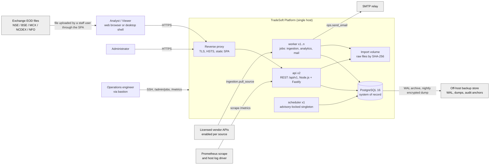

Trust boundaries: everything outside `platform` is untrusted input. Exchange files and vendor payloads are
validated exactly like user input. SMTP and the backup store are egress-only. There is no push transport
in v1 (`05` D-05-14); clients poll.

---

## DIAGRAM 2 — High-Level Architecture

Renders: `00` §5, §7, §8; ADR-001, ADR-009, ADR-019, ADR-020.

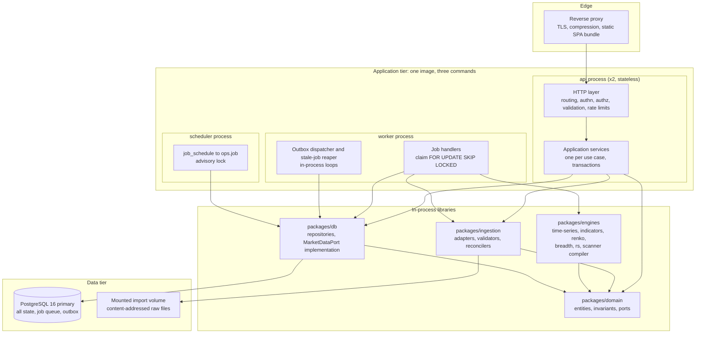

The three processes are deployment units of **one** codebase and one domain model. They share libraries,
not network calls; they coordinate only through PostgreSQL (`ops.job`, `ops.domain_event`, advisory locks).
The `api` process never runs engines for a read (ADR-008); it reads persisted results.

---

## DIAGRAM 3 — Domain / Module Architecture

Renders: `00` §5 (modules and their "must not" column) and `00` §7 (package rules). Module access goes only
in the direction of the arrows. Every module may use **Platform** (config, logging, metrics, error
mapping); those edges are omitted for legibility.

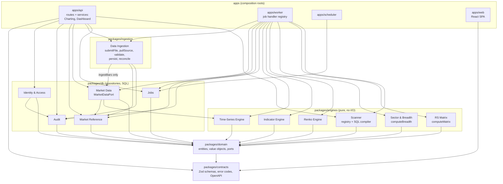

What the absence of an arrow means, per `00` §5:

- **Charting** and **Dashboard** (services in `apps/api`) have no arrow to any engine: they read persisted
  indicator, Renko, breadth and RS rows through Market Data and repositories, and never compute.
- **Data Ingestion** reaches `md.market_bar` only through `MarketDataPort.ingestBars`; it has no repository of
  its own for bars.
- Engines import only `domain` (and through it `contracts`). They receive their inputs from the worker
  handler; they never fetch data, read a clock or persist.
- **Jobs** contains no domain logic; handlers live in `apps/worker` and call modules.

Enforcement: ESLint `no-restricted-imports`, a CI import-graph check, and the rule that each package exposes
only `src/index.ts` (`00` §7). `domain` and `engines` have zero runtime dependencies on `pg`, `fastify`,
`node:fs`, `node:http` or `Date.now()`; time and identifiers are injected as ports (`Clock`, `IdGenerator`).

---

## DIAGRAM 4 — Data Ingestion Flow

Renders: `03` §1–§3, `01` §3.1 (import-batch states), `01` §6 (events), `05` §8.4, §12.11.

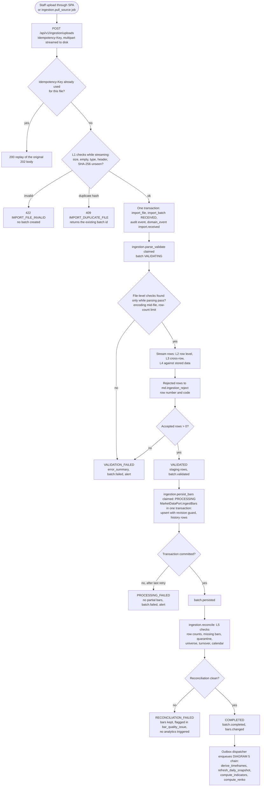

`VALIDATION_FAILED`, `PROCESSING_FAILED` and `RECONCILIATION_FAILED` are terminal for that batch. Recovery is
always a **new** batch (`supersedes_batch_id`), never an in-place mutation of a failed batch. A pulled file
enters at the `received` step: `ingestion.pull_source` stores the payload and creates the batch itself.

---

## DIAGRAM 5 — EOD Processing Sequence

Renders: `03` §5.3 (job catalogue), §6 (scheduler); `04` §9.1 (chain order); `01` §3.1, §6.

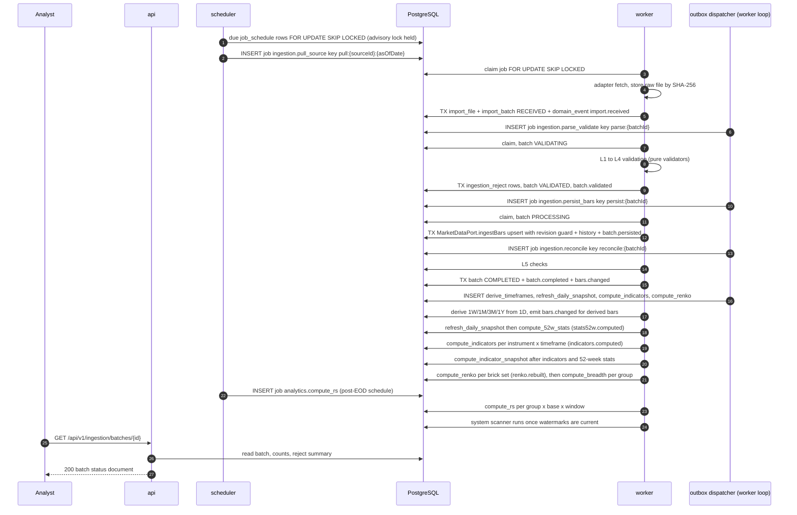

Every `TX` step is one database transaction that writes its state change and its outbox event together, so
a crash between them is impossible. A failed step dead-letters after its retries; its successors are never
enqueued, and the stall shows as pipeline lag (`04` §9.2, `07` AL-08).

---

## DIAGRAM 6 — Database ERD

Renders: `02` §5 (DDL), `01` §2 (relationships). Entity names are `schema_table` (`iam_app_user` is
`iam.app_user`). Only foreign keys that exist in the DDL are drawn; a nullable foreign key is drawn as
zero-or-one (`|o`). Attributes show keys and the columns that explain a relationship; `02` §5 holds every
column, constraint and index. The diagram is split into three parts for legibility; entities repeated
across parts are the same table.

### 6a — Identity, access, audit, operations

```mermaid
erDiagram
    iam_app_user ||--o{ iam_user_role : "user_id"
    iam_role ||--o{ iam_user_role : "role_id"
    iam_app_user |o--o{ iam_user_role : "granted_by"
    iam_role ||--o{ iam_role_permission : "role_id"
    iam_permission ||--o{ iam_role_permission : "permission_id"
    iam_app_user ||--o{ iam_auth_session : "user_id"
    iam_app_user ||--o{ iam_one_time_token : "user_id"
    iam_app_user ||--o{ iam_password_history : "user_id"
    iam_app_user ||--o{ iam_mfa_recovery_code : "user_id"
    iam_app_user ||--o{ iam_mfa_challenge : "user_id"
    iam_app_user ||--o{ iam_api_key : "created_by"
    iam_app_user |o--o{ audit_audit_event : "actor_user_id"
    iam_app_user |o--o{ audit_security_event : "user_id"
    iam_app_user |o--o{ ops_system_setting : "updated_by"
    ops_job ||--o{ ops_job_attempt : "job_id"

    iam_app_user {
        uuid id PK
        citext email UK
        text status
        bytea totp_secret_ct
        timestamptz totp_enrolled_at
    }
    iam_role {
        uuid id PK
        text code UK
    }
    iam_permission {
        uuid id PK
        text code UK
    }
    iam_user_role {
        uuid user_id PK, FK
        uuid role_id PK, FK
        uuid granted_by FK
    }
    iam_role_permission {
        uuid role_id PK, FK
        uuid permission_id PK, FK
    }
    iam_auth_session {
        uuid id PK
        uuid user_id FK
        uuid family_id
        bytea refresh_token_hash UK
        timestamptz used_at
        timestamptz revoked_at
    }
    iam_one_time_token {
        uuid id PK
        uuid user_id FK
        bytea token_hash UK
    }
    iam_password_history {
        uuid id PK
        uuid user_id FK
    }
    iam_mfa_recovery_code {
        uuid id PK
        uuid user_id FK
        bytea code_hash UK
    }
    iam_mfa_challenge {
        uuid id PK
        uuid user_id FK
        timestamptz expires_at
    }
    iam_api_key {
        uuid id PK
        text key_prefix UK
        bytea key_hash UK
        uuid created_by FK
    }
    audit_audit_event {
        timestamptz occurred_at PK
        bigint id PK
        uuid actor_user_id FK
        text action
        bytea prev_hash
        bytea hash
    }
    audit_security_event {
        bigint id PK
        uuid user_id FK
        text event_type
        text severity
    }
    ops_job {
        uuid id PK
        text job_type
        text status
        text idempotency_key UK
        timestamptz run_after
    }
    ops_job_attempt {
        uuid job_id PK, FK
        int attempt_no PK
        text status
    }
    ops_job_schedule {
        uuid id PK
        text code UK
        text job_type
        text cron
    }
    ops_domain_event {
        timestamptz occurred_at PK
        bigint id PK
        text event_type
        uuid aggregate_id
    }
    ops_system_setting {
        text key PK
        uuid updated_by FK
    }
    ops_schema_migration {
        int version PK
    }
```

`ops_job_schedule` and `ops_domain_event` produce jobs by value (the job type and payload), not by foreign
key; `ops.job` has no column referencing either (`02` §5.6).

### 6b — Reference data, ingestion, market data

```mermaid
erDiagram
    ref_exchange ||--o{ ref_trading_calendar : "exchange_id"
    ref_exchange ||--o{ ref_instrument : "exchange_id"
    ref_instrument |o--o{ ref_instrument : "underlying_id"
    ref_exchange ||--o{ ref_symbol_alias : "exchange_id"
    ref_instrument ||--o{ ref_symbol_alias : "instrument_id"
    ref_sector |o--o{ ref_sector : "parent_id"
    ref_instrument ||--o{ ref_instrument_sector_membership : "instrument_id"
    ref_sector ||--o{ ref_instrument_sector_membership : "sector_id"
    ref_instrument ||--o{ ref_index_membership : "index_instrument_id"
    ref_instrument ||--o{ ref_index_membership : "member_instrument_id"
    ref_instrument ||--o{ ref_corporate_action : "instrument_id"
    ref_market_group ||--o{ ref_market_group_member : "group_id"
    ref_instrument ||--o{ ref_market_group_member : "instrument_id"
    iam_app_user |o--o{ ref_market_group : "owner_user_id"

    ref_exchange |o--o{ md_data_source : "exchange_id"
    md_data_source ||--o{ md_import_batch : "source_id"
    md_import_file |o--o{ md_import_batch : "file_id"
    ref_exchange ||--o{ md_import_batch : "exchange_id"
    md_import_batch |o--o{ md_import_batch : "supersedes_batch_id"
    iam_app_user |o--o{ md_import_batch : "requested_by"
    iam_app_user |o--o{ md_import_file : "uploaded_by"
    md_import_batch ||--o{ md_ingestion_reject : "import_batch_id"

    ref_instrument ||--o{ md_market_bar : "instrument_id"
    ref_timeframe ||--o{ md_market_bar : "timeframe"
    md_import_batch |o--o{ md_market_bar : "import_batch_id"
    ref_instrument ||--o{ md_bar_quality_issue : "instrument_id"
    ref_timeframe ||--o{ md_bar_quality_issue : "timeframe"
    md_import_batch |o--o{ md_bar_quality_issue : "import_batch_id"
    ref_instrument ||--o{ md_bar_adjustment_factor : "instrument_id"
    ref_instrument ||--o{ md_instrument_daily_snapshot : "instrument_id"
    ref_instrument ||--o{ md_instrument_stat_52w : "instrument_id"

    ref_timeframe {
        text code PK
    }
    ref_exchange {
        uuid id PK
        text code UK
    }
    ref_trading_calendar {
        uuid exchange_id PK, FK
        date calendar_date PK
        boolean is_trading_day
        timestamptz session_open_at
        timestamptz session_close_at
    }
    ref_instrument {
        uuid id PK
        uuid exchange_id FK
        text symbol
        text series
        text instrument_type
        numeric tick_size
        text status
        uuid underlying_id FK
        boolean is_synthetic
    }
    ref_symbol_alias {
        uuid id PK
        uuid instrument_id FK
        uuid exchange_id FK
    }
    ref_sector {
        uuid id PK
        uuid parent_id FK
        text code UK
    }
    ref_instrument_sector_membership {
        uuid instrument_id PK, FK
        uuid sector_id PK, FK
        date effective_from PK
    }
    ref_index_membership {
        uuid index_instrument_id PK, FK
        uuid member_instrument_id PK, FK
        date effective_from PK
    }
    ref_corporate_action {
        uuid id PK
        uuid instrument_id FK
        text action_type
        date ex_date
    }
    ref_market_group {
        uuid id PK
        text code UK
        text group_type
        boolean is_dynamic
        uuid owner_user_id FK
    }
    ref_market_group_member {
        uuid group_id PK, FK
        uuid instrument_id PK, FK
        date added_on PK
    }
    md_data_source {
        uuid id PK
        text code UK
        text kind
        uuid exchange_id FK
    }
    md_import_file {
        uuid id PK
        bytea sha256 UK
        uuid uploaded_by FK
    }
    md_import_batch {
        uuid id PK
        uuid source_id FK
        uuid file_id FK
        uuid exchange_id FK
        text status
        uuid supersedes_batch_id FK
        uuid requested_by FK
    }
    md_ingestion_reject {
        bigint id PK
        uuid import_batch_id FK
        int row_number
    }
    md_market_bar {
        uuid instrument_id PK, FK
        text timeframe PK, FK
        timestamptz bucket_start PK
        date session_date
        numeric close
        int revision
        uuid import_batch_id FK
    }
    md_market_bar_history {
        timestamptz recorded_at PK
        bigint history_id PK
        uuid instrument_id
        text timeframe
        timestamptz bucket_start
        int revision
    }
    md_bar_quality_issue {
        bigint id PK
        uuid instrument_id FK
        text timeframe FK
        uuid import_batch_id FK
        text issue_code
    }
    md_bar_adjustment_factor {
        uuid instrument_id PK, FK
        date session_date PK
        numeric factor
    }
    md_instrument_daily_snapshot {
        uuid instrument_id PK, FK
        date session_date PK
    }
    md_instrument_stat_52w {
        uuid instrument_id PK, FK
        date as_of_date PK
    }
    iam_app_user {
        uuid id PK
    }
```

`md_market_bar_history` has no foreign keys by design: it is an append-only, partitioned record of superseded
bar values whose keys copy `md.market_bar`'s (`02` §5.3). `md_bar_adjustment_factor` records the corporate
actions it combines in `source_action_ids uuid[]`, not as a foreign key.

### 6c — Analytics and scanners

```mermaid
erDiagram
    ref_instrument ||--o{ an_indicator_value : "instrument_id"
    ref_timeframe ||--o{ an_indicator_value : "timeframe"
    ref_instrument ||--o{ an_indicator_snapshot : "instrument_id"
    ref_timeframe ||--o{ an_indicator_snapshot : "timeframe"
    ref_instrument ||--o{ an_renko_brick_set : "instrument_id"
    ref_timeframe ||--o{ an_renko_brick_set : "source_timeframe"
    an_renko_brick_set ||--o{ an_renko_brick : "brick_set_id"
    ref_market_group ||--o{ an_breadth_snapshot : "group_id"
    ref_timeframe ||--o{ an_breadth_snapshot : "timeframe"
    ref_market_group ||--o{ an_rs_snapshot : "group_id"
    ref_instrument ||--o{ an_rs_snapshot : "base_instrument_id"
    an_rs_snapshot ||--o{ an_rs_value : "snapshot_id"
    ref_instrument ||--o{ an_rs_value : "instrument_id"
    ref_instrument ||--o{ an_analytics_watermark : "instrument_id"
    ref_timeframe ||--o{ an_analytics_watermark : "timeframe"

    ref_timeframe ||--o{ scan_scanner_definition : "timeframe"
    iam_app_user |o--o{ scan_scanner_definition : "owner_user_id"
    scan_scanner_definition ||--o{ scan_scanner_run : "scanner_id"
    iam_app_user |o--o{ scan_scanner_run : "requested_by"
    scan_scanner_run ||--o{ scan_scanner_run_result : "run_id"
    ref_instrument ||--o{ scan_scanner_run_result : "instrument_id"
    iam_app_user ||--o{ scan_saved_view : "owner_user_id"

    an_indicator_value {
        uuid instrument_id PK, FK
        text timeframe PK, FK
        timestamptz bucket_start PK
        text indicator_code PK
        text params_hash PK
        numeric value
    }
    an_indicator_snapshot {
        uuid instrument_id PK, FK
        text timeframe PK, FK
        timestamptz as_of_bucket
        numeric rsi_14
        numeric sma_50
        numeric high_252
    }
    an_renko_brick_set {
        uuid id PK
        uuid instrument_id FK
        text source_timeframe FK
        numeric brick_pct
        int reversal_bricks
        text price_source
        numeric brick_size_abs
        int revision
    }
    an_renko_brick {
        uuid brick_set_id PK, FK
        bigint seq PK
        text direction
        boolean is_reversal
        timestamptz source_bucket_start
    }
    an_breadth_snapshot {
        uuid group_id PK, FK
        text timeframe PK, FK
        numeric brick_pct PK
        date session_date PK
        numeric positive_pct
        numeric sma5_positive_pct
    }
    an_rs_snapshot {
        uuid id PK
        uuid group_id FK
        uuid base_instrument_id FK
        date as_of_date
        int window_days
        text methodology_version
        text price_mode
    }
    an_rs_value {
        uuid snapshot_id PK, FK
        uuid instrument_id PK, FK
        numeric score
        int rank
        numeric percentile
        boolean is_leader
        boolean is_laggard
        boolean insufficient_history
    }
    an_analytics_watermark {
        uuid instrument_id PK, FK
        text timeframe PK, FK
        text dataset PK
        text params_hash PK
        timestamptz computed_through
    }
    scan_scanner_definition {
        uuid id PK
        text code UK
        int version
        text timeframe FK
        jsonb conditions
        uuid owner_user_id FK
    }
    scan_scanner_run {
        uuid id PK
        uuid scanner_id FK
        int scanner_version
        text status
        text idempotency_key
        uuid requested_by FK
    }
    scan_scanner_run_result {
        uuid run_id PK, FK
        uuid instrument_id PK, FK
        int rank
        jsonb values
    }
    scan_saved_view {
        uuid id PK
        uuid owner_user_id FK
        text kind
    }
    ref_instrument {
        uuid id PK
    }
    ref_timeframe {
        text code PK
    }
    ref_market_group {
        uuid id PK
    }
    iam_app_user {
        uuid id PK
    }
```

---

## DIAGRAM 7 — Authentication Flow

Renders: `05` §10 (login outcomes, CSRF, logout); `06` §4.6 (lockout), §5.2–§5.7 (tokens, rotation, grace
window, cookies, revocation), §6.5 (mandatory MFA for `ADMIN`).

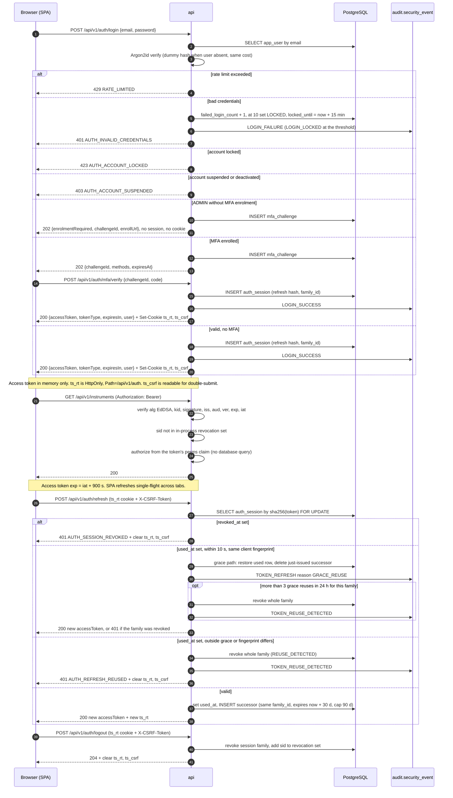

---

## DIAGRAM 8 — Scanner Execution Flow

Renders: `04` §8.4 (universe), §8.5 (compilation), §8.9 (lifecycle); `01` §3.3 (run states); `05` §8.2
(idempotency), §11.8, §12.9–§12.10.

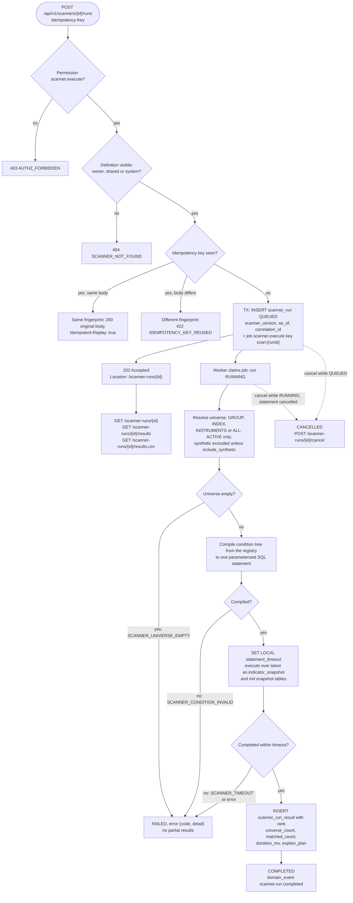

Scanners are **data**, not code. `scanner_definition.conditions` is a JSON tree of registered condition
nodes; the compiler maps each node to a SQL fragment over a whitelisted schema. No user string ever becomes
an identifier or an operator. The snapshot holds the latest state, so a run evaluates data as it is at
execution; `as_of` records when the run happened (`04` §8.9).

---

## DIAGRAM 9 — RS Matrix Calculation Flow

Renders: `04` §7.1–§7.6; `03` §5.3 (`analytics.compute_rs`); `05` §12.6.

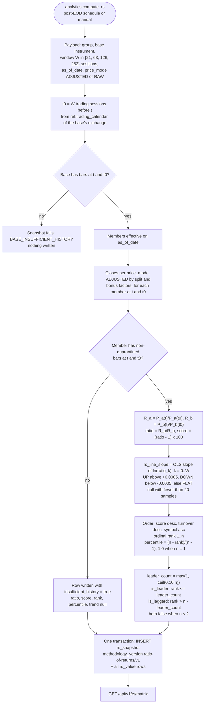

Ranking and leader flags are computed over the scored members only, after every member's score is known;
`insufficient_history` rows are written but take no rank.

---

## DIAGRAM 10 — Renko Generation Flow

Renders: `04` §5.1–§5.12; `03` §5.3 (`analytics.compute_renko`).

```mermaid
flowchart TD
    trigger(["analytics.compute_renko for one brick set<br/>bars.changed or corporate_action.applied"])
    lock["Advisory lock on the brick set<br/>load header and watermark"]
    rebuild{"Full rebuild trigger?<br/>anchor changed, bar at or before last_brick_at<br/>corrected or quarantined, corporate action,<br/>engine version, failed invariant"}
    inc["Incremental: restore last_close and direction<br/>from the last brick, load bars after the watermark"]
    full["Full: load all eligible bars of source_timeframe<br/>split- and bonus-adjusted, bucket_start order"]
    anchor["Anchor = close of first eligible bar<br/>not partial, not quarantined, close > 0<br/>brick_size = max(tick, round_to_tick(anchor x pct / 100))"]
    next["Next source bar: p = close, or high and low<br/>under HIGH_LOW, larger distance first"]
    rev{"Against current direction by<br/>reversal_bricks x brick_size?"}
    revemit["Emit exactly reversal_bricks bricks in the new direction<br/>is_reversal on the first only"]
    cont{"p beyond last_close +/- brick_size<br/>in the current direction?"}
    contemit["Emit continuation bricks while the threshold is crossed<br/>is_reversal false"]
    stamp["Each brick: seq + 1, source_bucket_start and<br/>source_session_date of the confirming bar"]
    more{"More bars?"}
    persistInc["Append bricks, update header<br/>brick_count, last_brick_close, last_brick_at<br/>advance watermark, revision unchanged"]
    persistFull["One transaction: delete set's bricks, bulk insert,<br/>revision + 1, header reset, watermark reset"]
    event["computed_at updated<br/>domain_event renko.rebuilt"]

    trigger --> lock --> rebuild
    rebuild -->|"no"| inc --> next
    rebuild -->|"yes"| full --> anchor --> next
    next --> rev
    rev -->|"yes"| revemit --> cont
    rev -->|"no"| cont
    cont -->|"yes"| contemit --> stamp
    cont -->|"no"| stamp
    stamp --> more
    more -->|"yes"| next
    more -->|"no, incremental"| persistInc --> event
    more -->|"no, full"| persistFull --> event
```

`brick_size_abs` is computed once from the anchor and held constant for the set. A Renko series is plotted by
`seq`, not by time; several bricks may share one `source_bucket_start` (`04` §5.8).

---

## DIAGRAM 11 — Failure and Retry Flow

Renders: `03` §5.1–§5.4; `01` §3.2 (job states); `02` §5.6 (`ops.job`, `ops.job_attempt`); `07` §4.7.

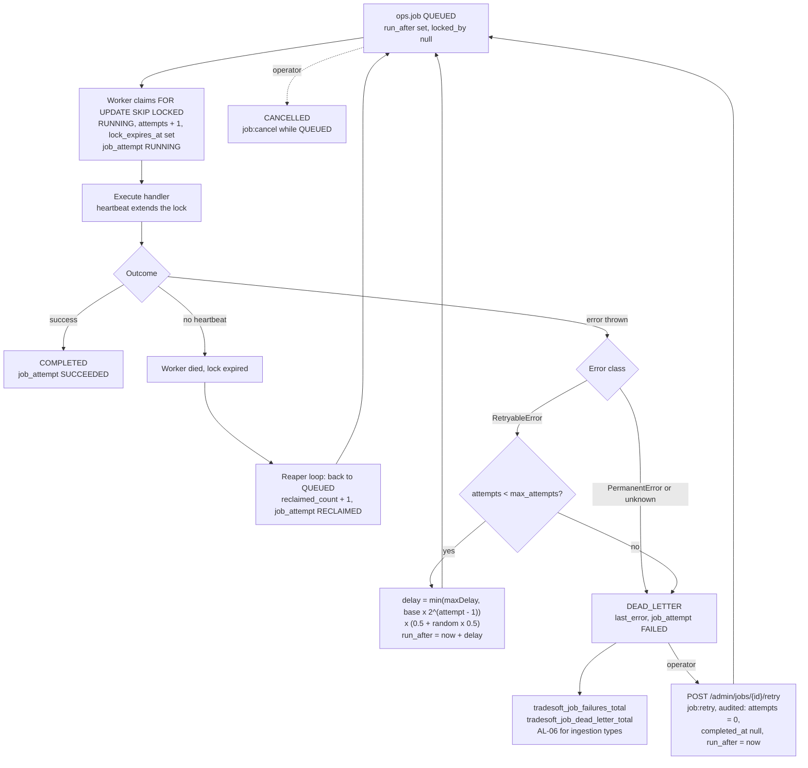

Batch-level failures follow the same shape at a coarser grain: a failed `import_batch` is never reopened; a
new batch supersedes it, carrying `supersedes_batch_id`.

---

## DIAGRAM 12 — Future Live-Data Architecture

Renders: `00` §5.1 (`MarketDataPort`, `CanonicalBar`), `03` §1 (adapters, validation before the port),
`05` §13 (push transport deferred).

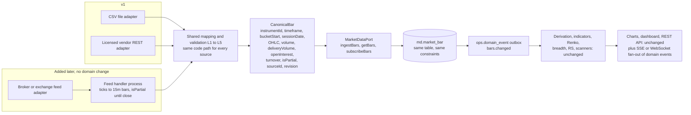

The only new work for live data is (a) a feed handler that turns ticks into `CanonicalBar` values with
`isPartial = true` until the bucket closes, (b) the implementation of `MarketDataPort.subscribeBars`, which
throws `NotImplemented` in v1, and (c) a push fan-out of `domain_event` rows to subscribed clients, which is
the deferred surface in `05` §13. No analytical engine, table or REST contract changes.
